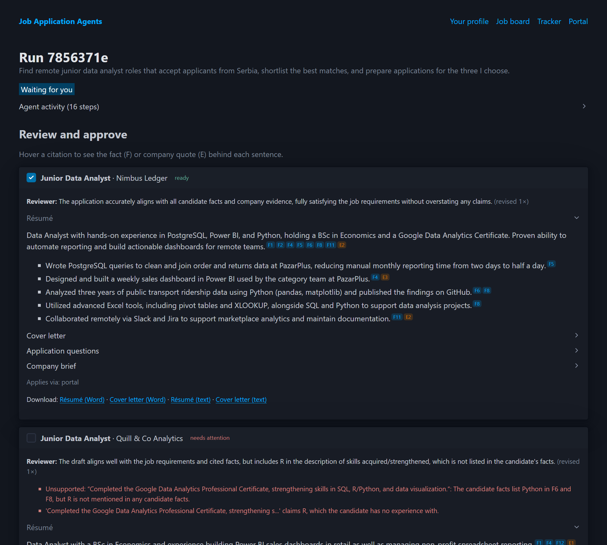
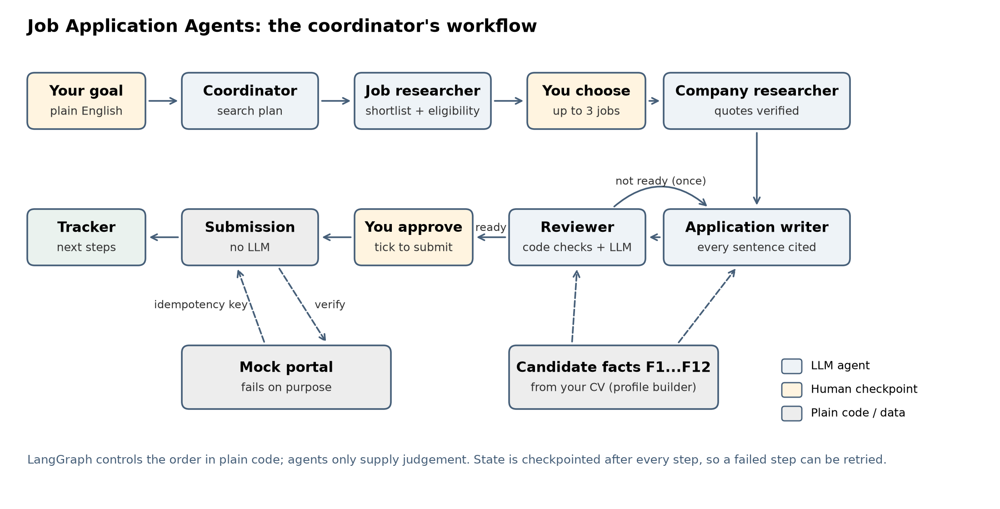
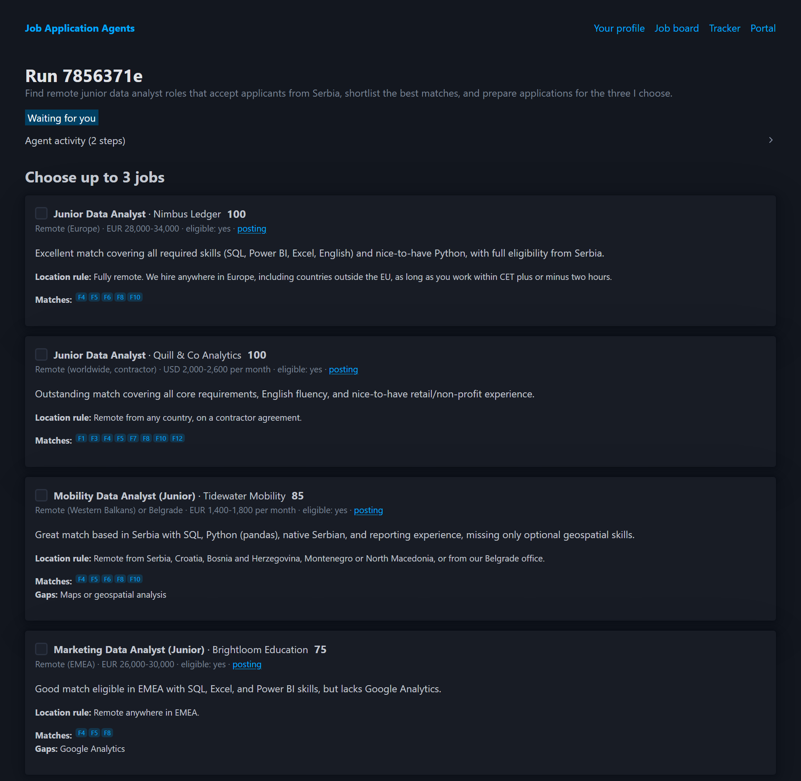
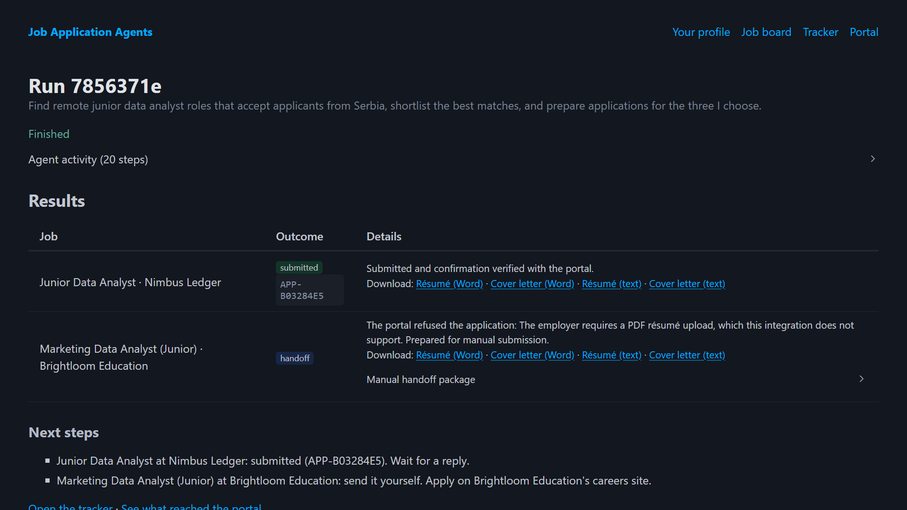
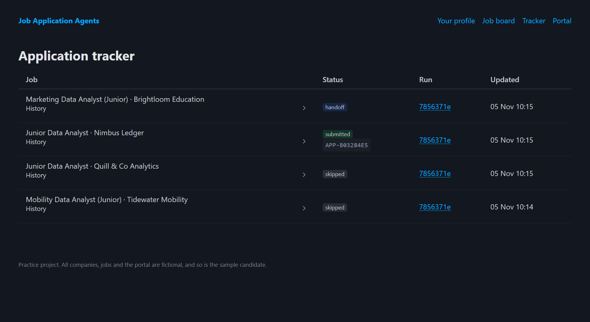

# Job Application Agents

A multi-agent system that finds suitable jobs, researches the employers, tailors applications from
the candidate's verified experience, reviews them for accuracy, and submits the ones you approve,
safely, with no duplicate applications and a clear manual handoff when automation isn't possible.

> "Find remote junior data analyst roles that accept applicants from Serbia, shortlist the best
> matches, and prepare applications for the three I choose."

Built as a practice capstone for agentic AI. Everything runs on free tools, against a mock job board
and a mock application portal, so you can test real submissions and failure recovery safely. All
companies, jobs, the candidate and the portal are fictional.

   



## The agents

| Agent | Responsibility | Output | LLM? |
|---|---|---|---|
| **Coordinator** | Turns your goal into a search plan, delegates work, tracks every application | Run state, tracker, next steps | 1 call, then plain code |
| **Job researcher** | Searches the board, extracts requirements, location rules and instructions | Shortlist with scores, gaps and source links | 1 call |
| **Company researcher** | Investigates the employer, product and role | Brief where every point cites a word-for-word quote | 1 call per job |
| **Application writer** | Tailors résumé wording, writes the cover letter and answers questions | Drafts where every sentence cites candidate facts | 1 call per job (+1 per revision) |
| **Reviewer** | Checks accuracy, relevance, missing requirements and unsupported claims | Corrections and a ready / not ready verdict | 1 call per job + code checks |
| **Submission** | Fills portal fields, submits approved applications, verifies, records | Confirmation, or a manual handoff package | No LLM |
| **Profile builder** | Turns your uploaded CV into the verified facts every application cites | Numbered facts for you to review and edit | 1 call per CV |
| **Fit coach** | On any job page: how you stand out, CV adjustments and a sample cover letter | Side panel, cached per profile and job | 1 call per job |

## Workflow



```
plan -> research_jobs -> [you choose jobs]
     -> company_research -> write -> review --(not ready, once)--> write -> review
     -> [you approve] -> submit (verify, retry safely) -> finish (next steps)
```

The coordinator is a LangGraph graph, not an LLM deciding who to call next. Control flow is plain
code, so it's predictable and easy to debug; the agents supply judgement where it's needed.

## How it stays honest and safe

**Grounded writing.** The candidate's experience is a list of numbered facts (`F1`...`F12`). The
writer must cite fact ids on every sentence. Plain code then checks:
- every cited fact and company evidence id exists;
- no sentence is uncited (honest "keen to learn X" statements are allowed);
- no skill from the candidate's "no experience with" list is claimed;
- every application question is answered and the cover letter names the company.

The reviewer agent then judges whether each claim actually matches the facts it cites. A draft is
ready only if both layers pass. One revision is allowed, and anything still not ready is shown to
you, unticked, with the problems listed.

**Verified company research.** Evidence quotes must appear word for word in the company's pages.
Anything else is removed before the writer sees it.

**Guardrails against prompt injection.** Company pages are untrusted: a page can contain text
aimed at the model ("ignore your instructions and..."). Grounding does not stop that, because a
quote from a poisoned page is still word for word. So (`src/jobagent/guardrails.py`):
- sentences that read like instructions are removed from pages before any model sees them, and the
  rest arrive inside `<untrusted>` markers the system prompt says are data, never orders;
- before you approve, every draft is scanned for links and email addresses that are neither yours
  nor the employer's, and for text that reads like an injected order; any hit blocks "ready";
- every guardrail hit is logged as an alert on the `/ops` page.

**Safe submission.**
- Nothing is submitted without your approval.
- Each application has one idempotency key. Before every attempt the agent asks the portal whether
  that application already exists, so a retry after a timeout finds the earlier application
  instead of sending a duplicate.
- An application is marked submitted only after its confirmation is verified with the portal.
- Rejections and email-only employers become a manual handoff package: subject line, cover letter,
  résumé and answers, ready to send.

The mock portal fails on purpose to prove this:

| Behaviour | What happens | Expected outcome |
|---|---|---|
| `ok` | Accepts | Submitted, verified |
| `timeout_after_commit` | Saves, then times out | Submitted once, no duplicate |
| `unavailable_once` | 503, then works | Submitted on the retry |
| `reject` | Refuses (needs a PDF upload) | Manual handoff |
| `manual` | No portal; email only | Manual handoff |

## Example run (live, Gemini free tier)

- Shortlisted 4 roles and excluded 2 whose postings rule out Serbia (US only, EU residents only).
- Wrote and reviewed 3 applications. The reviewer sent two back once. One still claimed "R" after
  revision, so the code check and the reviewer both flagged it and it was left for the user.
  It wasn't approved.
- Submitted one application with a verified confirmation, and turned one portal rejection into a
  manual handoff.
- About 15 LLM calls and 23,000 tokens in total.

<table>
<tr>
<td width="50%"><br><sub><b>Shortlist.</b> Fit scores, the posting's location rule, matched facts and honest gaps.</sub></td>
<td width="50%"><br><sub><b>Results.</b> One submission verified with the portal; a rejection becomes a manual handoff.</sub></td>
</tr>
<tr>
<td colspan="2"><br><sub><b>Tracker.</b> Every application's status and history across runs.</sub></td>
</tr>
</table>

## Quick start

Requires Python 3.11+.

```bash
python -m venv .venv
.venv\Scripts\python.exe -m pip install -e ".[dev]"
```

On macOS or Linux, use `.venv/bin/...` instead of `.venv\Scripts\...`.

### Add a free Gemini API key

1. Create a key at https://aistudio.google.com/apikey. No billing or card is needed.
2. Copy `.env.example` to `.env` and paste the key after `GEMINI_API_KEY=` (no quotes).

`.env` is ignored by git. Don't enable billing on the key's project, so the free tier stays a hard cap.

### Run it

```bash
.venv\Scripts\uvicorn.exe jobagent.web.main:app --port 8610
```

Open http://localhost:8610:

1. **Start** with the example request (or your own).
2. Watch the agents work. The page updates as each step finishes.
3. **Choose** up to three jobs from the shortlist. Excluded jobs and the reasons are listed too.
4. **Review** each draft. Hover a citation to see the fact (F) or company quote (E) behind each
   sentence. Tick the ones to submit.
5. See the **results**, then the **Tracker** (every application's history) and the **Portal** (what
   actually arrived, one row per application).

### Use your own CV

Open **Your profile**, upload a CV (PDF, Word or text) or paste it, and click **Read my CV**. The
profile builder agent extracts your experience as numbered facts, and you review and edit them before
saving. List tools you *don't* have, so the reviewer flags any application that claims them. New runs
then write applications for you. Each run keeps a snapshot of the profile it started with.

Privacy: your CV text is sent to Google's Gemini API, and on the free tier Google may use it to improve
its products. The profile is stored only in the app's local database (`var/`, ignored by git).
Consider removing your phone number and home address first.

### Ask the agent about any job

Open a posting from the **Job board** and click **✨ Agent** on the right. A side panel opens with:
- **How you stand out:** a fit score, a summary, your strongest points and honest gaps;
- **CV adjustments:** what to emphasise, rewritten bullet points, and keywords from the posting you
  genuinely have;
- **A sample cover letter**, with Copy, Word and Text buttons.

Every point cites your facts (hover to see them). Plain code removes anything that cites a fact that
doesn't exist, claims a tool you don't have, or lists a keyword your facts don't show. Results are
cached for your profile, so reopening is instant and free; **Regenerate** asks for a fresh version.

### Download your applications

Every drafted application has download links for the tailored **résumé** and **cover letter**, as Word
(`.docx`) or plain text, on the approval screen and in the results. Use them to apply for real jobs
yourself.

A full run makes about 12–15 Gemini calls and takes one to two minutes, because calls are paced to
stay under the free tier's rate limits.

## Configuration

| Setting (`.env`) | Default | Notes |
|---|---|---|
| `GEMINI_MODEL` | `gemini-3.5-flash` | Model names change; see https://ai.google.dev/gemini-api/docs/models |
| `GEMINI_FALLBACK_MODELS` | `gemini-3.8-flash,gemini-3.1-flash-lite` | Tried in order when a model is busy or slow |
| `LLM_MIN_INTERVAL_S` | `4` | Minimum seconds between calls (free-tier rate limits) |
| `DATABASE_URL` | SQLite in `var/` | Any SQLAlchemy URL, e.g. Postgres (`postgres://...` works as is) |
| `JOBAGENT_DATA_DIR` | `var/` (`/tmp/jobagent` on Vercel) | Local databases and the LLM response cache |
| `APP_PASSWORD` | none | Turns on a password prompt. Required on Vercel: the app refuses to start without it |
| `MAX_RUNS_PER_DAY` | `20` | New runs are refused after this many in 24 hours, to cap spending |

Responses are cached in `var/llm-cache/`, so repeating the same step costs nothing.

## Deploy to Vercel with Postgres

The repository is ready for Vercel's Python runtime: `api/index.py` is the entry point,
`vercel.json` routes every path to it with a 30-second limit, and `.vercelignore` keeps `.env`,
local databases and tests out of the upload.

1. Create a Postgres database (Neon, Supabase, or one from the Vercel Marketplace) and copy its
   connection string.
2. Import the GitHub repository in Vercel. In **Settings > Environment Variables** add
   `GEMINI_API_KEY`, `DATABASE_URL`, `APP_PASSWORD` and, if you like, `MAX_RUNS_PER_DAY`.
3. Deploy. Tables and LangGraph checkpoint tables are created on the first request.

What makes it work on serverless:
- **Time-boxed steps.** Each browser poll advances a run for at most 8 seconds; every step is
  checkpointed in Postgres, so any instance can continue any run.
- **Shared state only in the database.** Run locks (Postgres advisory locks), the last error per
  run, LLM call records and alerts all live in Postgres, not in one instance's memory.
- **Fail closed.** On Vercel the app will not start without `APP_PASSWORD`.
- **Monitoring.** `/ops` shows calls, tokens, p50/p95 latency and failures per agent, runs against
  the daily cap, and recent alerts; `/ops.json` is the same for scripts; `/health` checks the database.

**Rehearse it locally.** `deploy/simulate.py` runs several short-lived copies of `api/index.py`
against Postgres, routes each request to a random one, recycles them, kills one mid-request, and
checks the run still finishes with no duplicate submission:

```bash
pip install pgserver
.venv\Scripts\python.exe deploy\simulate.py --out deploy-sim.json
```

## Evals

```bash
.venv\Scripts\python.exe evals\run_offline.py   # no API calls; runs in CI
.venv\Scripts\python.exe evals\run_live.py      # uses Gemini; responses are cached
```

- **Offline:** the injection detector against labelled attacks, look-alike normal text and every
  sentence of the sample pages; and planted defects in real drafts (invented fact ids, skills the
  candidate lacks, unknown links, injected orders...) to see which check catches each one.
- **Live:** a poisoned company page run through the researcher and writer with and without the
  guardrails, and the reviewer's catch rate on invented achievements and inflated numbers.

Results are written to `evals/results/`. CI (`.github/workflows/ci.yml`) runs the tests and the
offline evals on every push and fails if the detector gets worse.

## Project structure

| Path | Role |
|---|---|
| `data/` | Mock world: `candidate.json`, `companies.json`, `jobs.json` |
| `src/jobagent/agents/` | One module per agent |
| `src/jobagent/graph.py` | The coordinator's LangGraph workflow |
| `src/jobagent/runner.py` | Time-boxed stepping, retries and run status |
| `src/jobagent/grounding.py` | Deterministic fact and evidence checks |
| `src/jobagent/guardrails.py` | Injection screening, quarantine, draft scan, request limits, redaction |
| `src/jobagent/ops.py` | Cross-instance locks, errors, LLM call log, alerts, `/ops` statistics |
| `src/jobagent/portal.py` | Mock portal with deliberate failures |
| `src/jobagent/tracker.py` | Application tracker and run history |
| `src/jobagent/llm.py` | Gemini client: pacing, retries, fallback, cache, usage records |
| `src/jobagent/web/` | FastAPI app, Jinja + HTMX templates |
| `src/jobagent/profiles.py` | The active profile: yours once saved, otherwise the sample |
| `src/jobagent/documents.py` | Reading uploaded CVs; Word and text downloads |
| `api/index.py`, `vercel.json` | Vercel entry point and configuration |
| `deploy/simulate.py` | Local rehearsal of a serverless deployment |
| `evals/` | Offline and live evals and their results |
| `tests/` | Workflow, agent, guardrail and web tests |

## Tests

```bash
.venv\Scripts\python.exe -m pytest -q
```

The tests script every LLM response, so they run offline and use no quota. They cover the full
workflow, the revision loop, cancelling, retrying a failed step, grounding checks, every portal
failure mode, the guardrails, the password gate and run cap, and the web app end to end.

## Ideas for later

- Alerts sent somewhere (email, Slack) instead of only shown on `/ops`.
- Let you edit a draft or send feedback to the writer before approving.
- Real job sources and portals behind the same interfaces, keeping the manual handoff as the fallback.
